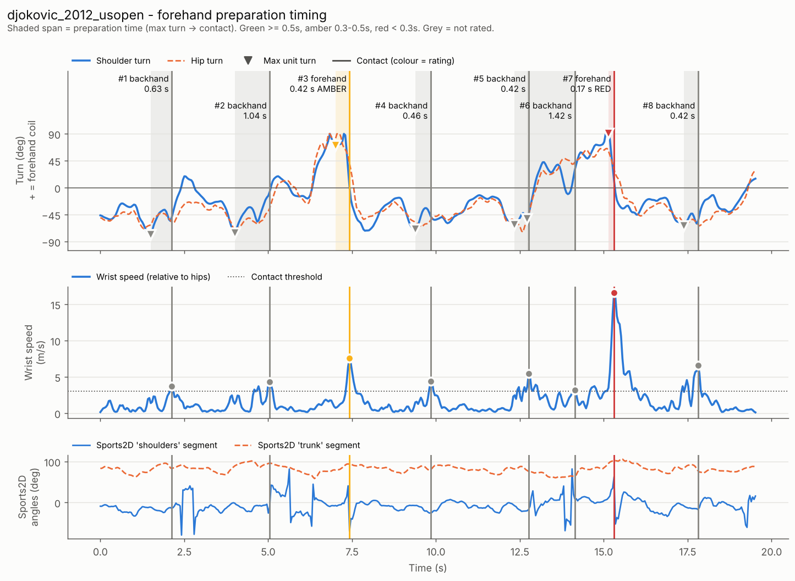
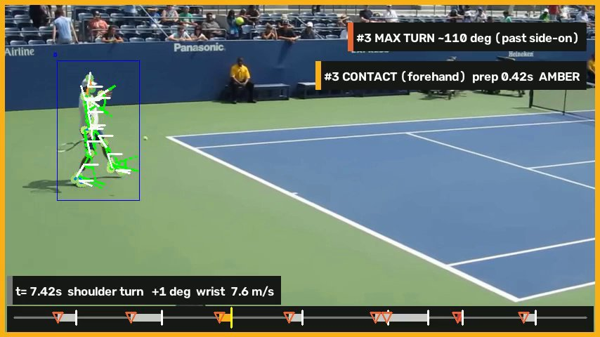

# Forehand preparation timing (Sports2D)

Measures how early you prepare your forehand: the time from **maximum unit turn**
(shoulders fully turned) to **contact**, for every swing in your clips, using
[Sports2D](https://github.com/davidpagnon/Sports2D) for pose tracking.

```bash
python analyse.py clips/
```

| Rating | Preparation time (contact - max turn) |
|---|---|
| 🟢 green | ≥ 0.5 s |
| 🟠 amber | 0.3 – 0.5 s |
| 🔴 red | < 0.3 s |



*Example output on openly licensed footage of Novak Djokovic (2012 US Open, 24 fps,
panning camera). See [`examples/`](examples) and "Validation on pro footage" below.*

---

## Setup on a Mac (Apple Silicon)

Needs **Python 3.11, 3.12 or 3.13** and **macOS 15 or later**: Sports2D depends on
OpenSim, whose macOS wheels are built for macOS 15+.

```bash
# 1. Python (skip if `python3 --version` already shows 3.11-3.13)
brew install python@3.12
```

```bash
# 2. Get the code and make a virtual environment
git clone -b claude/dazzling-maxwell-jc2786 https://github.com/Chubbystaffy/tennis-analysis.git
cd tennis-analysis
python3.12 -m venv .venv
source .venv/bin/activate
pip install --upgrade pip
pip install -r requirements.txt
```

```bash
# 3. Check it works (runs the unit tests in a second or two)
python -m pytest -q
```

The first analysis downloads the pose models (~150 MB, from download.openmmlab.com) into
`~/.cache/rtmlib`. Sports2D runs the pose model on the CPU (ONNX Runtime). For reference, on a
4-core cloud machine it managed 3–5 frames/s on 1080p crowd footage and ~5.5 frames/s on a
480p clip; an M-series Mac should be faster, but a 10 s, 240 fps slo-mo clip (2,400 frames) will
still take a few minutes. Sports2D results are cached, so only the first run of each clip is slow.

> **On macOS 14 or older**, `pip install` fails on `opensim`. Use conda instead:
> `conda create -n tennis python=3.12 && conda activate tennis && conda install -c opensim-org opensim && pip install -r requirements.txt`.

## Filming

The turn measurement assumes this set-up, so it matters:

* **Side-on**: the camera at the side of the court, looking along the baseline at you,
  so the net is to the left or right of the frame. A tripod at about chest height.
* **Whole body in frame, feet included**, for every shot. Sports2D ignores people
  with fewer than 65 % of keypoints visible (that is how it ignores spectators).
* **Fixed camera.** No panning or zooming.
* **iPhone slo-mo (120 or 240 fps).** AirDrop the clip to the Mac with
  *Options → All Photos Data* switched on (or in Photos on the Mac: *File → Export →
  Export Unmodified Original*), so the file keeps its real 240 fps timing. If you
  instead export a slowed-down 30 fps video, set `SLOWMO_FACTOR = 8` (240 / 30)
  in `analyse.py`. The summary prints the frame rate it read, so check it says 240.
* Right-handed by default; set `PLAYER_HAND = "left"` otherwise.
* Clips of 5–30 s with several forehands work well. Every clip in the folder is
  analysed; Sports2D results are cached, so re-running after changing a threshold is fast.

## Running

```bash
python analyse.py clips/                    # every video in clips/
python analyse.py clips/rally1.mov          # one clip
python analyse.py clips/ --no-video         # skip the annotated video (faster)
python analyse.py clips/ --rerun            # force Sports2D to run again
python analyse.py clips/ --racquet          # also track racquet-tip tape (below)
python analyse.py --tune-colour clips/a.mov # find the HSV range of your tape
```

If `clips/` is empty, the Sports2D demo video (someone walking) is analysed with
relaxed thresholds, just to show the pipeline works.

To try it on real pro footage first:

```bash
python fetch_examples.py        # ~55 MB of CC BY / BY-SA clips from Wikimedia Commons, as .mp4
python analyse.py example_clips/
```

## Output

```
results/
  summary.txt                     combined summary across all clips
  all_swings.csv                  every swing from every clip
  <clip>/
    <clip>_annotated.mp4          Sports2D's skeleton video + max-turn / contact banners,
                                  a pause on each marked frame and a swing timeline
    <clip>_chart.png              shoulder & hip turn, wrist speed, Sports2D angles, swings
    <clip>_swings.csv             one row per swing
    <clip>_frames.csv             per-frame data (turn, speeds, Sports2D angles, ...)
    <clip>_summary.txt            short text summary
    sports2d/                     raw Sports2D output (.trc, .mot, its video, log)
```

`<clip>_swings.csv` columns: `stroke` (forehand / backhand / serve/overhead),
`contact_time_s`, `contact_speed`, `max_turn_time_s`, `max_turn_deg`, `hip_turn_at_max_deg`,
`shoulder_hip_separation_deg`, `prep_time_s`, `rating` and `flags` (warnings such as
"clip starts inside the 1.5 s window", "small turn", "tracking gap before contact").

## How it works

1. **Sports2D** (`sports2d` CLI) tracks the player and writes 2D keypoints (`.trc`, pixels and
   metres) plus joint and segment angles (`.mot`) and its annotated video. The largest fully
   visible person is analysed.
2. **Shoulder turn.** Seen side-on, a player facing the net shows almost no shoulder
   width; fully turned, the shoulder line lies across the image and looks its full width.
   So turn = `arcsin(projected shoulder width / full width)`, with width measured relative
   to torso length (so zoom and distance cancel out). It is signed by which shoulder leads
   towards the net: **positive = forehand coil**, negative = backhand coil. The same is done
   for the hips.

   Sports2D's own `shoulders` and `trunk` segment angles are also loaded, saved and plotted.
   They are not used for the turn: they measure the *tilt* of those lines in the image,
   which a side-on camera cannot turn into rotation (`TURN_SOURCE = "sports2d_shoulders"`
   switches to them if you want to compare).
3. **Wrist speed**: the hitting wrist, relative to the hip centre (so running and camera
   motion don't look like a swing), in m/s, Gaussian-smoothed.
4. **Swings**: contact = peak of wrist speed (or racquet-tip speed), peaks at least 0.8 s
   apart, above an absolute floor and a fraction of the clip's typical fast swing.
5. **Max unit turn**: peak shoulder turn in the 1.5 s before contact. Good players often
   turn *past* side-on (beyond 90°); the projected width then shrinks again, so the turn curve
   shows two near-90° peaks with a dip between them. The dip is taken as the true maximum
   (reported as 180° minus the dip).
6. **Stroke type**: the direction of the coil before contact (forehand vs backhand); wrist
   above the head at contact = serve/overhead. Only forehands are rated
   (`RATE_STROKES`).
7. Frames where Sports2D lost the player (it bridges gaps by straight-line interpolation)
   or where the skeleton jumps impossibly fast are blanked rather than analysed.

### Optional racquet-tip tracking

Put a band of **fluorescent pink or orange** tape on the racquet tip (avoid yellow/green:
tennis balls are that colour) and run with `--racquet`. Each frame, OpenCV thresholds the
HSV image and picks the tape blob near the hitting hand, ignoring blobs on the
hips/knees/feet/other wrist (clothing, wristbands) and anything that never moves
(background). Positions go into `<clip>_frames.csv` (`racquet_x_px`, `racquet_y_px`). If the
tape is found in ≥ 60 % of frames, its speed is used for contact (`CONTACT_SIGNAL`).

Tune the colour on your own footage:

```bash
python analyse.py --tune-colour clips/rally1.mov
```

Drag the sliders until only the tape is highlighted, press `q`, and paste the printed
range into `TAPE_HSV_RANGES` at the top of `analyse.py`. `results/<clip>/racquet_mask_preview.jpg`
shows what was detected (in magenta).

## Tuning

Every threshold is in the **CONFIG** section at the top of `analyse.py`. The ones you are
most likely to change after looking at your first chart:

| Setting | Default | Change it when |
|---|---|---|
| `SLOWMO_FACTOR` | 1 | your clip was exported as slowed-down 30 fps (then 8) |
| `MIN_CONTACT_SPEED_MPS` | 3.0 | real swings are missed (lower) / shadow swings counted (raise) |
| `MIN_PEAK_FRACTION` | 0.35 | same, relative to your typical swing speed |
| `MIN_SWING_GAP_S` | 0.8 | — (from the spec) |
| `TURN_SEARCH_WINDOW_S` | 1.5 | — (from the spec) |
| `GREEN_MIN_S`, `AMBER_MIN_S` | 0.5, 0.3 | you want different rating bands |
| `PLATEAU_DEG`, `DIP_MIN_DEG` | 75, 8 | "coiled past side-on" fires on noise (raise `DIP_MIN_DEG`) |
| `SPORTS2D_PERSON_ORDERING` | `largest_size` | someone bigger/closer than you is in frame |
| `SPORTS2D_FILTER_CUTOFF_HZ` | 10 | the wrist speed looks jagged (lower) |

**The thresholds were developed on pro match footage, not on your slow-mo clips.** Expect
to adjust `MIN_CONTACT_SPEED_MPS` / `MIN_PEAK_FRACTION` after checking the first chart: every
real forehand should have a contact marker, and nothing else should.

## Validation on pro footage

No test clips were provided, so the pipeline was built and checked on openly licensed
match footage from Wikimedia Commons (`fetch_examples.py`), comparing the tool's output with
frame-by-frame inspection of the video.

**Djokovic, 2012 US Open** (court level, roughly side-on, 24 fps, panning camera): the
closest match to the intended set-up.

| Stroke (seen in video) | Contact (video) | Tool | Notes |
|---|---|---|---|
| backhand | ≈ 2.0 s | backhand @ 2.13 s | |
| backhand | ≈ 4.7 s | backhand @ 5.05 s (wrist) / 4.75 s (racquet tape test) | |
| **forehand** | ≈ 7.35 s | **forehand @ 7.42 s, max turn 7.00 s, prep 0.42 s, amber** | deepest coil seen at 6.92–7.08 s ✓ |
| backhand | ≈ 9.75 s | backhand @ 9.84 s | |
| backhand | ≈ 12.9 s | backhand @ 12.76 s | |
| *(running, no stroke)* | | backhand @ 14.14 s | false positive (not rated) |
| **forehand** | ≈ 15.2 s | forehand @ 15.31 s, prep 0.17 s, red | **wrong prep**: the camera whips away at contact, so tracking is lost |
| backhand | ≈ 17.85 s | backhand @ 17.81 s | |

All 7 real strokes found and correctly classified; one false positive (an unrated
"backhand"). For the clean forehand, max turn and contact match the video to within a
frame (42 ms) and the 110° coil past side-on was correctly recognised. The second forehand
shows why the camera must not move.



**Sharapova, Amelia Island** (court level, 29 fps, camera moves and zooms): the forehand at
16.5 s is found and timed (prep 0.55 s, green). The forehand at 13.9 s is labelled
*backhand*: she is facing the camera there, not side-on, so the turn sign flips. A
"forehand" at 8.3 s is a tracking artefact while the camera zooms; it has a 10° turn, so it
is flagged and not rated.

**Racquet tape** (synthetic pink dot drawn onto the Djokovic clip, at the racquet-tip
position): found in 92 % of frames, median error 0.8 px, wrong blob in 1.7 % of frames
(red shorts stripe / a spectator in a panning shot).

**2026 US Open clips from the stands** (Alcaraz/Wu, Pegula; 60 fps, fixed phone high in the
stands about 45° behind the baseline). Checked against the video: Pegula's two two-handed
backhands (4.7 s, 7.25 s in clip 03) and, in Alcaraz/Wu clip 18, a backhand at 1.85 s and a
running forehand at 7.08 s were detected and classified correctly. But this camera angle is far
from side-on, so the **turn angles and prep times are not valid** for these clips. They are
a tracking test only. Where spectators' heads hide the near player's feet, the
"fully visible person" filter that keeps spectators out also drops the player: clip 35 is
tracked for only 29 % of its length (the summary warns about this), and four other clips from
the series (and Pegula 03 with the final settings) had no trackable player and were left out
of `fetch_examples.py`.

## Limitations

* **2D, single camera.** Turn is inferred from foreshortening, which only works when the
  camera is side-on and level. From behind, in front or high up, turn angles and prep times
  are wrong. Turn beyond 90° is recovered only through the "dip" heuristic, and angles
  near 90° are imprecise (the sine is flat there).
* **Max turn is the turn signal's peak or dip**, a proxy for "unit turn complete". On
  24 fps footage it moves by ±1–2 frames (±0.1 s) between runs on re-encoded copies of
  the same clip. 240 fps slo-mo is far better.
* **Contact = wrist-speed peak**, which can sit a frame or two after the real ball
  contact. Racquet tape is closer. The contact frame is not detected from the ball.
* **Left/right keypoint swaps** by the pose model (common side-on) flip the turn sign for a
  few frames and can misclassify a stroke. Check the chart.
* **Stroke classification** is a heuristic (coil direction): slices, defensive shots and
  volleys may be mislabelled. Non-swing arm movements fast enough to pass the threshold can be
  counted (they are usually labelled backhand and not rated).
* **One player per clip.** The largest fully visible person is analysed; if a coach or
  another player is closer to the camera, crop the clip or change `SPORTS2D_PERSON_ORDERING`.
* **Metres** come from Sports2D's height-based scaling (or torso length if that fails),
  so speeds are approximate. They only need to be consistent within a clip.
* The thresholds have **not** been tuned on your own slow-mo footage yet.

## Credits

* [Sports2D](https://github.com/davidpagnon/Sports2D) (Pagnon, D., & Kim, H. (2024). Sports2D:
  Compute 2D human pose and angles from a video or a webcam. *Journal of Open Source
  Software*, 9(101), 6849) with RTMPose via [rtmlib](https://github.com/Tau-J/rtmlib).
* Example clips: Wikimedia Commons, CC BY 2.0 / CC BY-SA 2.0 / CC BY-SA 4.0. Authors and
  links are written to `example_clips/ATTRIBUTION.txt` by `fetch_examples.py`; the images in
  `examples/` are credited in [`examples/README.md`](examples/README.md).
